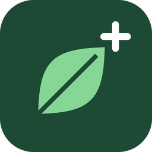

<div align="center">



# Pflanzenmonitor Plus

[](https://github.com/SH1FT-W/pflanzenmonitor-plus/releases/latest)
[](https://www.home-assistant.io)
[](https://hacs.xyz)

<a href="https://sh1ft-w.github.io/pflanzenmonitor-plus"><b>Website</b></a>&emsp;<a href="#loslegen">Loslegen</a>&emsp;<a href="#umzug-aus-dem-plant-monitor">Umzug aus dem Plant Monitor</a>&emsp;<a href="#entitaeten">Entitäten</a>&emsp;<a href="CHANGELOG.md">Changelog (englisch)</a>&emsp;<a href="README.md">English</a>

</div>

<br/>

Pflanzenmonitor Plus überwacht jede Pflanze in Home Assistant an ihren Grenzwerten, lernt aus dem Bodenfeuchte-Verlauf, **wann gegossen wurde und wann sie wieder Wasser braucht**, und lässt auf Wunsch eine KI passende Grenzwerte zur Pflanzenart vorschlagen. Alles läuft lokal aus der Statistik von Home Assistant; nur die optionalen KI-Anfragen gehen an die KI, die du eingerichtet hast.

Plus kann, was der [Plant Monitor](https://github.com/Olen/homeassistant-plant) kann, ist aber eine eigene Integration und übernimmt nichts daraus: Der Umstieg sind [wenige Schritte je Pflanze](#umzug-aus-dem-plant-monitor). Die Zustands-Entität heißt `sensor.<name>` statt `plant.<name>`, die Flower Card wird nicht unterstützt.

## Was du bekommst

| Funktion | Braucht |
|:--|:--|
| Zustand je Pflanze (OK oder Problem), Messwerte, Grenzwerte, Logbuch, Automationen | Beliebige Sensoren der Pflanze |
| VPD, PPFD und Tageslicht | Temperatur und Luftfeuchte, oder einen Lichtsensor |
| Gießen in X Tagen, zuletzt gegossen (erkennt es selbst), Abtrocknung | Einen Bodenfeuchtesensor mit Langzeitstatistik (`state_class: measurement`) |
| Regen zählt nicht als Gießen | Draußen: einen Regensensor in mm/h |
| Regen erwartet, Frostgefahr | Draußen: eine Wetter-Entität mit stündlicher Vorhersage |
| Grenzwerte von einer KI vorgeschlagen, du gibst frei | Eine KI-Aufgaben-Entität (`ai_task`, zum Beispiel aus der Anthropic- oder OpenAI-Integration) |
| Gieß-Aufgaben auf einer To-do-Liste | Eine To-do-Liste, in den Optionen gewählt |
| Pflegekalender fürs Düngen und Umtopfen | Die Option *Pflegekalender* (Standard aus); mit KI ein Pflegeplan je Jahreszeit |

**Neu in 26.11:** Gieß-Aufgaben auf einer To-do-Liste und ein optionaler Pflegekalender. Plus zieht Pflanzen nicht mehr selbst aus dem Plant Monitor um; dafür gibt es eine Anleitung. Alle Änderungen stehen im [Changelog](CHANGELOG.md) (englisch).

<a id="loslegen"></a><a id="installation"></a><a id="einrichtung"></a>
## Loslegen

[](https://my.home-assistant.io/redirect/hacs_repository/?owner=SH1FT-W&repository=pflanzenmonitor-plus&category=integration)

Du brauchst Home Assistant 2026.9 oder neuer mit Recorder (Standard).

1. **Installieren.** Unter **Einstellungen > Marketplace** (vor Home Assistant 2026.11 heißt er HACS) nach **Pflanzenmonitor Plus** suchen, herunterladen und Home Assistant neu starten.
2. **Integration hinzufügen.** **Einstellungen > Geräte & Dienste > Integration hinzufügen > Pflanzenmonitor Plus**. Es gibt genau einen Eintrag; die Pflanzen hängen darunter.
3. **Optionen wählen** (alle optional, später unter **Konfigurieren**): die KI für Grenzwert-Vorschläge, eine Wetter-Entität, eine To-do-Liste fürs Gießen, den Pflegekalender, einen Regensensor. Der Regensensor muss die Intensität in mm/h messen; Mengen-Sensoren („Regen heute“) bleiben bis Mitternacht über 0.
4. **Pflanze hinzufügen.** **Pflanzenmonitor Plus > Pflanze hinzufügen** fragt in vier Schritten: Name, Art (hilft der KI), Raum und Bild; die Sensoren und ob sie draußen steht; welche Messwerte als Problem zählen und die Wartezeit nach dem Gießen; mit Pflegekalender den Pflegeplan. **Drei-Punkte-Menü > Neu konfigurieren** ändert dasselbe später.

Plus legt nur Entitäten zu vorhandenen Sensoren an. Ein abgewählter Sensor nimmt seine Entitäten mit, seine Grenzwerte bleiben gespeichert. Benennst du einen Sensor um, zieht Plus das nach.

<details>
<summary>Von Hand installieren</summary>

1. Das [neueste Release](https://github.com/SH1FT-W/pflanzenmonitor-plus/releases/latest) herunterladen.
2. Den Ordner `custom_components/pflanzenmonitor_plus` nach `/config/custom_components/` kopieren und Home Assistant neu starten.

</details>

<a id="umzug-aus-dem-plant-monitor"></a>
## Umzug aus dem Plant Monitor

Plus liest, ändert und entfernt nichts vom Plant Monitor. Solange er eingerichtet ist, zeigt **Einstellungen > Reparaturen** einen Hinweis mit Link hierher. Jede Pflanze ziehst du von Hand um:

1. **Einstellungen der Pflanze notieren** im Plant Monitor: Sensoren, Grenzwerte (seine Min- und Max-Entitäten), Art, Bild, welche Messwerte als Problem zählen, die Wartezeit nach dem Gießen und den Raum.
2. **Die Pflanze zuerst im Plant Monitor löschen.** Damit werden ihre Entitäts-IDs frei; sonst bekommt Plus IDs mit `_2` am Ende, und die bleiben. Der alte Verlauf bleibt unter den alten IDs.
3. **In Plus hinzufügen** mit demselben Namen und den echten Sensoren, die der Plant Monitor genutzt hat, und **Raum leer lassen**: Mit Raum stellt Home Assistant ihn jeder neuen Entitäts-ID voran. Den Raum danach am Gerät setzen, dann die Grenzwerte.
4. **`plant.<name>` ersetzen** durch `sensor.<name>` in Automationen, Skripten und Dashboards (gleiche Zustände und Attribute). Messwerte und Grenzwerte behalten ihre IDs, wo die Namen übereinstimmen. Ältere Pflanzen in einem nicht englisch eingestellten Home Assistant hatten englische IDs (`sensor.<pflanze>_soil_moisture`); Plus benennt sie in deiner Sprache, also diese auch ersetzen.
5. **Den Plant Monitor entfernen** im Marketplace, sobald alle Pflanzen umgezogen sind, und neu starten. Der Hinweis verschwindet.

Übernommen wird nichts: Entitätsnamen, Symbole, Labels, ausgeblendete oder deaktivierte Entitäten und die Lichtsummen des Plant Monitor beginnen neu. Die Gieß-Vorhersage lernt aus der Statistik des echten Feuchtesensors, und die bleibt. Mit Plus bis 26.11.2 umgezogen, das Pflanzen noch selbst übernahm? Für dich ändert sich nichts; Automationen, die noch `plant.<name>` nutzen, stehen weiter unter Reparaturen.

<a id="entitaeten"></a>
## Entitäten

Alle auf dem Gerät der Pflanze. Die IDs hängen von Sprache und Raum ab (zum Beispiel `sensor.schlafzimmer_bogenhanf_giessen_in`); auf der Geräteseite nachsehen.

| Entität | Zeigt |
|:--|:--|
| *Pflanzenname* (Zustand) | OK, Problem, oder unbekannt ohne Messwert. Attribute wie `plant.*` im Plant Monitor: Art, Zustand je Messgröße, Probleme |
| Bodenfeuchtigkeit, Temperatur, Bodentemperatur, Luftfeuchtigkeit, Beleuchtungsstärke, Leitfähigkeit, CO2 | Den Wert des echten Sensors. Attribut: Quellsensor |
| Dampfdruckdefizit, Tageslicht (DLI) | kPa aus Temperatur und Luftfeuchte; mol/m² seit Mitternacht, gestern als Attribut |
| Max und Min je Messgröße, Lux-zu-PPFD-Faktor | Die Grenzwerte, als Einstellungen auf der Geräteseite |
| Gießen in, Gießen fällig | Tage bis zur Untergrenze (0 = heute) und das Datum |
| Zuletzt gegossen | Erkannt an einem Sprung der Bodenfeuchte. Draußen auch der letzte Regen |
| Regen erwartet, Frostgefahr | Draußen mit Wetter: mindestens 1 mm in 12 Stunden; Vorhersage der nächsten 48 Stunden unter der Mindesttemperatur der Pflanze |
| KI-Vorschlag, mit Knöpfen | Der offene Vorschlag mit „alt zu neu“ und Grund je Grenzwert. Knöpfe: Übernehmen, Ablehnen, Zurücknehmen, KI jetzt fragen |

<details>
<summary>Diagnose-Entitäten, Pflegekalender, Aktionen und Ereignisse</summary>

- **Diagnose:** Abtrocknung (%/Tag über 72 Stunden), Lernstand (keine Daten, lernt noch, gelernt nach zwei Gießzyklen), PPFD, Lichtsumme gesamt, Licht der letzten 24 Stunden.
- **Pflegekalender** (Option): Kalender **Pflanzenpflege** (`calendar.pflanzenpflege`, englisch `calendar.plant_care`) mit Dünge- und Umtopf-Terminen als Ganztagstermine, dazu je Pflanze die Knöpfe **Gedüngt** und **Umgetopft**.
- **Aktionen:** `pflanzenmonitor_plus.replace_sensor` (`meter_entity`, `new_sensor`; leer entfernt ihn) und `pflanzenmonitor_plus.care_done` (`plant_entity`, `care`: `fertilized` oder `repotted`, optional `date`).
- **Ereignis:** `pflanzenmonitor_plus_suggestion` bei jedem neuen offenen KI-Vorschlag (`entity_id`, `summary`, `changes`).
- **Auslöser und Bedingungen** für die Zustands-Entität, auch über Raum oder Label: Problem erkannt oder behoben; je Messgröße zu niedrig, zu hoch oder OK; je Sensor veraltet (nicht verfügbar oder standardmäßig 24 Stunden ohne Meldung) oder meldet wieder.

</details>

<a id="beispiele"></a>
## Beispiele

Eine Benachrichtigung, wenn eine Pflanze seit 30 Minuten Aufmerksamkeit braucht:

```yaml
triggers:
  - trigger: pflanzenmonitor_plus.problem_detected
    target:
      label_id: pflanzen
    options:
      behavior: each
      for:
        minutes: 30
actions:
  - action: notify.mobile_app_handy
    data:
      message: "{{ trigger.to_state.name }} braucht Aufmerksamkeit"
```

<details>
<summary>Erinnerung am Morgen, wenn im Pflegekalender etwas fällig ist</summary>

```yaml
triggers:
  - trigger: calendar
    event: start
    entity_id: calendar.pflanzenpflege
actions:
  - action: notify.mobile_app_handy
    data:
      message: "{{ trigger.calendar_event.summary }}"
```

</details>

## Deine Daten

- **Lokal.** Lernen und Vorhersage nutzen die Statistik von Home Assistant. Keine zusätzlichen Pakete.
- **Die KI bekommt** Name, Art, Raum, drinnen oder draußen, Monat, Land, Grenzwerte, gelernte Zahlen und 30 Tage Messwerte. Keine Orte, keine Personen.
- **Die Diagnose** zeigt je Pflanze die erkannten Gießereignisse, gelernten Werte, Grenzwerte und den letzten KI-Vorschlag.

## Gut zu wissen

- Kleine Nachgüsse unter 10 Prozentpunkten werden nicht als Gießen erkannt. Direkt nach dem Einrichten nutzt „Gießen in“ nur das aktuelle Abtrocknungstempo; im Rückblick-Test an 7 Zimmerpflanzen über 120 Tage lag die gelernte Vorhersage typischerweise 1 bis 3 Tage daneben.
- Nach dem Umtopfen, einem neuen Sensor oder einem neuen Standort passen die alten Zyklen eine Weile nicht. Verlässlich wird die Vorhersage nach zwei neuen Zyklen; ein „Lernen zurücksetzen“ gibt es noch nicht.
- Die KI kann sich irren. Schutzregeln im Code begrenzen jeden Schritt, nichts ändert sich ohne deine Freigabe, und jede Änderung lässt sich zurücknehmen. Jede Anfrage kostet etwas bei deinem KI-Anbieter (etwa eine je Pflanze und Monat).
- Draußen ohne Regensensor bleiben Anstiege unbekannt und „Zuletzt gegossen“ leer; die Vorhersage funktioniert trotzdem.
- OpenPlantbook wird (noch) nicht unterstützt.

<details>
<summary>Zustand und Probleme</summary>

Wie im Plant Monitor, damit Automationen nur die neue Entitäts-ID brauchen:

- Jede Messgröße ist zu niedrig, zu hoch oder OK. Zurück geht es erst 5 % hinter der Grenze (höchstens 5 % der Spanne), kein Hin und Her.
- Die Pflanze hat ein Problem, wenn eine Messgröße, die zählt, außerhalb liegt. Helligkeit zählt nur, wenn es zu hell ist (dunkel ist es jede Nacht). Tageslicht wird gegen den Vortag geprüft. Mit einem PPFD-Lichtsensor gibt es keine lx-Prüfung.
- Springt die Bodenfeuchte um 10 Punkte oder mehr, zählt „zu nass“ während der Wartezeit nach dem Gießen nicht.
- Temperaturen werden in °C verglichen, auch von °F-Sensoren. Ein ausgefallener Sensor macht kein Problem und beendet keines.

</details>

<details>
<summary>So wird gelernt</summary>

1. Plus liest bis zu 120 Tage der stündlichen Statistik des Feuchtesensors, höchstens einmal pro Stunde.
2. **Gießen** ist ein Anstieg um mindestens 10 Punkte gegenüber dem Tiefstwert der drei Stunden davor. Stufen innerhalb von 12 Stunden zählen als eines; Lücken, kurze Einbrüche auf 0 und einzelne Ausreißer zählen nicht.
3. Ein **Zyklus** reicht von einem Gießen bis zum nächsten, mindestens 24 Stunden. Ab zwei Zyklen ist die Pflanze gelernt.
4. **Vorhersage:** Für die letzten drei Zyklen, wie lange die Erde vom heutigen Stand bis zur Untergrenze brauchte (Median), umgerechnet mit dem Abtrocknungstempo damals und heute (höchstens Faktor 3). Ohne passenden Zyklus das aktuelle Tempo.
5. **Ziel** ist die Untergrenze der Bodenfeuchte. Die Gießgewohnheit zeigt Plus nur als Info.

</details>

<details>
<summary>KI-Vorschläge</summary>

1. **Wann:** sobald eine Pflanze gelernt ist, danach höchstens alle 30 Tage, eine Pflanze je 10-Minuten-Durchlauf. „KI jetzt fragen“ fragt sofort. Ein offener Vorschlag wartet 30 Tage auf dich, dann wird er ersetzt.
2. **Was sie liefert:** Grenzwerte für Bodenfeuchte, Temperatur, Bodentemperatur, Luftfeuchte, Helligkeit und Tageslicht (nur die mit Sensor), je einen Grund und eine Sicherheit. Ohne Pflanzenart ist die Sicherheit höchstens „mittel“.
3. **Schutzregeln im Code:** je Vorschlag höchstens ±15 Punkte Feuchte oder Luftfeuchte, ±5 °C, ±2000 lx (min) bzw. ±20000 lx (max), ±5 bzw. ±10 Tageslicht; feste Bereiche je Wert und ein Abstand zwischen jeder Unter- und Obergrenze. Werte, die Plus noch nie geschrieben hat, dürfen einmal in einem Schritt ersetzt werden. Größere Änderungen gehen schrittweise, der nächste Schritt nach 7 statt 30 Tagen. Draußen geht die Mindesttemperatur nie unter −5 °C (Luft) bzw. 0 °C (Boden).
4. **Freigabe:** Übernehmen prüft die Regeln erneut gegen die Werte von jetzt und merkt sich die alten zum Zurücknehmen. Eine höhere Mindesttemperatur kann sofort ein Problem und „Frostgefahr“ auslösen.

Neue Vorschläge erscheinen auch unter **Einstellungen > Reparaturen**, mit Übernehmen und Ablehnen im Dialog.

</details>

<details>
<summary>Gieß-Aufgaben und Pflegekalender</summary>

**Gieß-Aufgaben:** Erreicht „Gießen in“ heute, legt Plus eine Aufgabe wie „Yucca gießen“ auf der gewählten Liste an, mit Fälligkeitsdatum, wenn die Liste das kann. Höchstens eine offene Aufgabe je Pflanze, auch über Neustarts. Plus hakt sie ab, sobald die Stundenstatistik den Anstieg bestätigt (ein bis zwei Stunden später). Hakst du sie selbst ab oder löschst sie, kommt die nächste erst, wenn die Pflanze gegossen wurde und wieder fällig ist. Pflanzen ohne Bodenfeuchtesensor bekommen keine Aufgaben.

**Pflegekalender:** Düngen alle N Tage in der Saison (Winterpause), Umtopfen alle N Jahre im ersten Monat der Saison. Standard März bis September alle 21 Tage, Umtopfen alle 2 Jahre; Südhalbkugel September bis März. Überfällige Termine bleiben auf heute. Mit KI fragt Plus einmal je Jahreszeit nach einem Pflegeplan je Pflanze und zeigt einen abweichenden unter Reparaturen (Abstand 7 bis 90 Tage, Umtopfen alle 1 bis 10 Jahre). Ausschalten entfernt Kalender und Knöpfe; die gespeicherten Termine bleiben.

</details>

<details>
<summary>Fehlersuche</summary>

- **„Keine Daten“:** Der Feuchtesensor hat noch keine Langzeitstatistik. Er braucht `state_class: measurement`.
- **„Gießen in“ unbekannt:** Noch kein Verlauf, oder die Erde trocknet gerade nicht ab (erste 24 Stunden nach dem Gießen).
- **Zustand unbekannt:** Kein Sensor der Pflanze meldet einen Wert. Messwert-Entitäten und ihren Quellsensor prüfen.
- **KI-Vorschlag bleibt „Noch keiner“:** Die Pflanze ist noch nicht gelernt, oder die KI hat nicht geantwortet (Attribut „Letzter Fehler“). „KI jetzt fragen“ zeigt den Fehler direkt.

Wenn du ein [Issue](https://github.com/SH1FT-W/pflanzenmonitor-plus/issues) öffnest, häng bitte die Diagnose an (**Pflanzenmonitor Plus > Drei-Punkte-Menü > Diagnose herunterladen**).

</details>

<details>
<summary>Entfernen</summary>

1. **Einstellungen > Geräte & Dienste > Pflanzenmonitor Plus > Drei-Punkte-Menü > Löschen**. Pflanzen, Geräte, Entitäten, Hinweise und gespeicherte Daten gehen; Aufgaben, die schon auf einer To-do-Liste stehen, bleiben. Eine einzelne Pflanze entfernt **Drei-Punkte-Menü > Löschen** an ihrem Unterpunkt.
2. Im Marketplace entfernen (oder `/config/custom_components/pflanzenmonitor_plus` löschen) und Home Assistant neu starten.

</details>

<details>
<summary>Entwicklung</summary>

```bash
python -m pytest tests -q -p no:logging --cov=custom_components.pflanzenmonitor_plus
uvx ruff check . && uvx ruff format --check .
uvx mypy@2.3.1 --python-executable <venv>/bin/python
python tools/pruefe-uebersetzungen.py    # strings.json gegen translations/*.json
```

Testpakete: `pip install -r requirements_test.txt`. GitHub Actions prüft dasselbe, dazu HACS-Prüfung und hassfest. Worauf sich der Code bei Home Assistant verlässt, steht in [`docs/ha-annahmen.md`](docs/ha-annahmen.md). Quality Scale: [selbst geprüft](custom_components/pflanzenmonitor_plus/quality_scale.yaml).

</details>

## Lizenz

[Apache License 2.0](LICENSE), Copyright 2026 SH1FT-W. Zum Plant Monitor siehe [`NOTICE`](NOTICE).

<sub>Pflanzenmonitor Plus ist ein eigenständiges Projekt. Es ist mit dem Plant Monitor (Olen/homeassistant-plant) kompatibel, enthält aber keinen Code daraus und gehört nicht dazu.</sub>

<br/>

<div align="center">
<a href="https://sh1ft-w.github.io"></a>
<br/>
<sub>Mehr Open Source für Home Assistant und den Mac auf <a href="https://sh1ft-w.github.io">sh1ft-w.github.io</a></sub>
</div>
