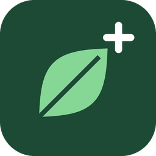

<p align="center"></p>

# Pflanzenmonitor Plus

[English](README.md) · [Website](https://sh1ft-w.github.io/pflanzenmonitor-plus) · [Changelog (englisch)](CHANGELOG.md)

Pflanzen-Integration für Home Assistant: überwacht jede Pflanze an ihren Grenzwerten, lernt aus dem
Bodenfeuchte-Verlauf, wann gegossen wurde und wann sie wieder Wasser braucht, und lässt auf Wunsch eine KI passende
Grenzwerte vorschlagen. Sie kann alles, was der [Plant Monitor](https://github.com/Olen/homeassistant-plant) (HACS)
kann, und übernimmt dessen Pflanzen auf Knopfdruck – danach braucht es ihn nicht mehr.

- **Zustand je Pflanze** („OK“/„Problem“) wie `plant.*` im Plant Monitor, mit denselben Attributen
  (`problems`, `moisture_status` usw., `species`) – Karten und Vorlagen laufen weiter
- **Messwerte** der echten Sensoren auf dem Gerät der Pflanze: Bodenfeuchte, Temperatur, Bodentemperatur,
  Luftfeuchte, Helligkeit (lx oder PPFD), Leitfähigkeit, CO2; dazu **VPD**, **PPFD**, **Lichtsumme** und
  **Tageslicht (DLI)** heute, gestern und der letzten 24 Std.
- **Grenzwerte** (Min/Max je Messgröße, Lux-zu-PPFD-Faktor) als Einstellungen auf der Geräteseite; je Messgröße
  wählbar, ob sie als Problem zählt; **Wartezeit nach dem Gießen** gegen Fehlalarme „zu nass“
- **Logbuch:** Beginn und Ende jedes Problems
- **Automationen:** eigene Auslöser und Bedingungen („Pflanze hat ein Problem“, „Bodenfeuchtigkeit zu niedrig
  geworden“, „Sensor veraltet“ …) und die Aktion „Sensor tauschen“
- **Gießen in X Tagen**: Vorhersage aus früheren Gießzyklen derselben Pflanze, umgerechnet auf das heutige
  Abtrocknungstempo (im Herbst trocknet es langsamer als im Sommer)
- **Zuletzt gegossen**: wird automatisch erkannt, sobald die Feuchte sprunghaft steigt; kein Knopf, nichts eintragen
- **Abtrocknung** in Prozentpunkten pro Tag und **Lernstand** („Lernt noch“, bis zwei Gießzyklen beobachtet sind)
- **KI-Vorschläge für Grenzwerte** (optional): Ist eine Pflanze gelernt, schlägt eine KI über die HA-eigene
  KI-Aufgabe (`ai_task`, z. B. Claude) passende Grenzwerte nach Pflanzenart vor – mit Begründung. Nichts ändert sich,
  bis du übernimmst; jede Übernahme lässt sich zurücknehmen.
- **Pflanzen draußen**: Regen zählt nicht als Gießen; dazu die Sensoren „Regen erwartet“ (≥ 1 mm in 12 Std.) und
  „Frostgefahr“ (Vorhersage der nächsten 48 Std. unter der Mindesttemperatur der Pflanze)
- **Hinweise unter Reparaturen**: Umzug aus dem Plant Monitor, neuer KI-Vorschlag (mit Übernehmen/Ablehnen direkt im
  Dialog), Automationen, die nach dem Umzug noch alte `plant.*`-Entitäten nutzen

Alles läuft lokal; nur die optionalen KI-Vorschläge gehen an die KI, die du in Home Assistant eingerichtet hast.
Keine zusätzlichen Pakete. OpenPlantbook wird (noch) nicht unterstützt.

> [!NOTE]
> Pflanzenmonitor Plus ist ein eigenständiges Projekt. Es ist mit dem Plant Monitor (Olen/homeassistant-plant)
> kompatibel, enthält aber keinen Code daraus und gehört nicht dazu. Lizenz: [Apache 2.0](LICENSE).

## Voraussetzungen

- Home Assistant 2026.9 oder neuer, Recorder aktiv (Standard)
- Je Pflanze ein Bodenfeuchtesensor fürs Lernen und die Gieß-Vorhersage (alle anderen Sensoren sind optional)
- Für Pflanzen draußen optional: eine Wetter-Entität mit stündlicher Vorhersage und ein Regensensor
- Für KI-Vorschläge optional: eine KI-Aufgaben-Entität (`ai_task`, z. B. über die Anthropic- oder
  OpenAI-Integration)

## Installation

1. In HACS über das Drei-Punkte-Menü **Benutzerdefinierte Repositories** öffnen,
   `https://github.com/SH1FT-W/pflanzenmonitor-plus` mit dem Typ **Integration** hinzufügen, **Pflanzenmonitor Plus**
   herunterladen – oder den Ordner `custom_components/pflanzenmonitor_plus` aus dem
   [neuesten Release](https://github.com/SH1FT-W/pflanzenmonitor-plus/releases/latest) nach
   `/config/custom_components/` kopieren.
2. Home Assistant neu starten.
3. *Einstellungen → Geräte & Dienste → Integration hinzufügen → Pflanzenmonitor Plus*.
4. Pflanzen anlegen: *Pflanzenmonitor Plus → Pflanze hinzufügen* – oder aus dem Plant Monitor übernehmen (unten).

### Einstellungen des Eintrags

Alle Felder sind optional und später unter *Pflanzenmonitor Plus → Konfigurieren* änderbar. Es gibt genau einen
Eintrag; die Pflanzen hängen als Unterpunkte darunter.

| Feld | Bedeutung |
|---|---|
| KI für Grenzwert-Vorschläge | KI-Aufgaben-Entität. Vorgeschlagen wird die erste vorhandene. Leer = keine KI-Vorschläge (und keine Knöpfe). |
| Wetter | Wetter-Entität mit stündlicher Vorhersage. Vorgeschlagen wird die erste vorhandene. Nur für Pflanzen draußen. |
| Regensensor | Gemessene Regenintensität in mm/h (Geräteklasse Niederschlagsintensität). Damit unterscheidet Plus bei Pflanzen draußen Regen vom Gießen. Ohne Regensensor – oder bevor er Verlauf hat – gelten Anstiege draußen als „unbekannt“. Mengen-Sensoren („Regen heute“) eignen sich nicht: sie bleiben nach einem Schauer bis Mitternacht über 0. |

### Pflanze anlegen und ändern

*Pflanze hinzufügen* fragt in drei Schritten; *⋮ → Neu konfigurieren* an der Pflanze ändert dieselben Angaben (der
Raum gilt dann über das Gerät).

| Schritt | Felder |
|---|---|
| Pflanze | Name, Art (z. B. „Dracaena trifasciata“; hilft der KI, steht als Modell am Gerät), Raum, Bild (URL oder `/local/…`) |
| Sensoren | Bodenfeuchte, Lufttemperatur, Bodentemperatur, Luftfeuchte, Helligkeit (lx oder PPFD), Leitfähigkeit, CO2; „Draußen“ (bei Räumen wie Terrasse, Balkon, Garten vorgewählt) |
| Probleme | Welche Messwerte als Problem zählen (Standard: alle außer VPD), Wartezeit nach dem Gießen in Minuten |

Plus legt nur Entitäten zu vorhandenen Sensoren an. Wird ein Sensor abgewählt, verschwinden seine Entitäten; seine
Grenzwerte bleiben gespeichert. Wird ein Sensor in HA umbenannt, zieht Plus das nach.

### Umzug aus dem Plant Monitor

Hat der Plant Monitor noch Pflanzen, erscheint unter *Einstellungen → Reparaturen* „Pflanzen aus dem Plant Monitor
übernehmen“. Der Dialog zeigt, was passiert, und zieht nach Bestätigung alle Pflanzen um:

- übernommen werden Sensoren, die **aktuellen** Grenzwerte (aus den Grenzwert-Entitäten, nicht die Startwerte im
  Eintrag; Temperaturen in °C umgerechnet), Art, Bild, welche Messwerte als Problem zählen, die Wartezeit, „draußen“,
  Raum und Labels des Geräts, Namen, Symbole, Labels, Ausblenden/Deaktivieren und Anzeige- und Assist-Einstellungen
  der Entitäten sowie der Live-Stand (Lichtsumme, Tageslicht heute und gestern, laufende Probleme)
- die Entitäts-IDs bleiben gleich, der Verlauf läuft weiter; nur `plant.<name>` wird zu `sensor.<name>`
- Gelerntes und KI-Verlauf von Plus bleiben erhalten
- danach sind die Pflanzen **aus dem Plant Monitor entfernt**; er lässt sich in HACS deinstallieren

Automationen und Skripte, die noch `plant.<name>` nutzen, listet Plus unter Reparaturen mit der neuen ID auf
(Dashboards kann HA nicht durchsuchen – dort selbst ersetzen).

## Entitäten

Alle Entitäten erscheinen auf dem Gerät der Pflanze. Die Entitäts-IDs hängen von Sprache und Raum ab (z. B.
`sensor.schlafzimmer_bogenhanf_giessen_in`) – für Automationen auf der Geräteseite nachsehen.

| Entität | Wert | Zusatzangaben |
|---|---|---|
| *Pflanzenname* (Zustand) | OK · Problem · unbekannt (kein Messwert) | Art, je Messgröße Zustand (zu niedrig/zu hoch/OK), Probleme (Messgröße, Zustand, Wert, Grenzen) |
| Bodenfeuchtigkeit, Temperatur, Bodentemperatur, Luftfeuchtigkeit, Beleuchtungsstärke, Leitfähigkeit, CO2 | Wert des echten Sensors (Einheit von dort); nach einem Neustart bis zu 10 Min. der letzte Wert, bis der Sensor wieder meldet | Quellsensor |
| Dampfdruckdefizit (VPD) | kPa aus Temperatur und Luftfeuchte | – |
| Tageslicht (DLI) | mol/m² seit Mitternacht | Gestern |
| PPFD, Lichtsumme gesamt, Licht letzte 24 Std. (Diagnose, ausgeblendet) | mol/(s·m²) bzw. mol/m² | – |
| Max/Min je Messgröße, Lux-zu-PPFD-Faktor (Einstellungen) | Grenzwerte; Temperaturen in der Systemeinheit | – |
| Gießen fällig | Zeitpunkt (HA zeigt „in 5 Tagen“); fällig = heute 0 Uhr | – |
| Gießen in | Tage bis zur Untergrenze, 0 = heute (für Automationen) | Fällig am, Untergrenze, Grundlage (frühere Zyklen oder aktuelles Tempo) |
| Zuletzt gegossen | Zeitpunkt | draußen: letzter Regen, Regenverlauf (vorhanden / noch keiner) |
| Abtrocknung (Diagnose) | %/Tag der letzten 72 Std.; in den ersten 24 Std. nach dem Gießen unbekannt | – |
| Lernstand (Diagnose) | Keine Daten · Lernt noch · Gelernt | Beobachtete Zyklen, benötigte Zyklen, „meist gegossen bei“ |
| Regen erwartet, Frostgefahr (nur draußen, mit Wetter) | an/aus | Menge, bis · Tiefstwert, Zeitpunkt, Mindesttemperatur der Pflanze |
| KI-Vorschlag (nur mit KI) | Noch keiner · Wartet auf Freigabe · Grenzwerte passen · Übernommen · Abgelehnt · Zurückgenommen | Zusammenfassung, je Grenzwert „alt → neu“ (ggf. „Ziel …, schrittweise“) und Grund, Sicherheit, Pflanzenart, gefragt, nächste Prüfung, zuletzt übernommen, letzter Fehler |
| Knöpfe (nur mit KI) | Vorschlag übernehmen · Vorschlag ablehnen (nur bei offenem Vorschlag) · Vorschlag zurücknehmen (nur direkt nach dem Übernehmen) · KI jetzt fragen | – |

Feuchte und Lernen brauchen den Bodenfeuchtesensor; ohne ihn gibt es nur Zustand, Messwerte und Grenzwerte.

**Wo man Vorschläge sieht:** Jeder offene Vorschlag erscheint unter *Einstellungen → Reparaturen* als
„<Pflanze>: neuer KI-Vorschlag für die Grenzwerte“. Antippen öffnet einen Dialog mit Zusammenfassung, Gründen und
Sicherheit – dort direkt **Übernehmen** oder **Ablehnen**. Danach verschwindet der Eintrag. Dasselbe geht auf der
Geräteseite der Pflanze über die Knöpfe.

## Zustand und Probleme

Wie im Plant Monitor, damit Automationen nach dem Umzug gleich weiterlaufen:

- Je Messgröße „zu niedrig“ (unter Min), „zu hoch“ (über Max) oder „OK“. Wer einmal zu niedrig ist, bleibt es, bis
  der Wert 5 % über der Grenze liegt (höchstens 5 % der Spanne); umgekehrt genauso – kein Hin und Her an der Grenze.
- Die Pflanze hat ein **Problem**, wenn eine Messgröße, die als Problem zählt, zu niedrig oder zu hoch ist.
  Helligkeit zählt nur, wenn es zu hell ist (dunkel ist es jede Nacht). Tageslicht wird gegen den Vortag geprüft;
  0 (nichts gemessen) gilt als OK. Liefert der Lichtsensor schon PPFD, gibt es keine lx-Prüfung.
- **Wartezeit nach dem Gießen:** Springt die Bodenfeuchte um 10 Punkte oder mehr, zählt „zu nass“ so lange nicht als
  Problem (der Zustand der Messgröße zeigt es trotzdem).
- Temperaturen werden in °C verglichen, auch wenn ein Sensor °F liefert.
- Ein ausgefallener Sensor macht kein Problem und beendet keines; im Logbuch steht das Ende erst, wenn er wieder
  einen Wert im Bereich meldet.

## Automationen

Auslöser (Ziel: die Zustands-Entität einer oder mehrerer Pflanzen, auch über Raum oder Label):

- Pflanze hat ein Problem · Pflanze wieder OK
- je Messgröße: zu niedrig geworden · zu hoch geworden · wieder OK (Bodenfeuchtigkeit, Leitfähigkeit, Temperatur,
  Luftfeuchtigkeit, CO2, Bodentemperatur, Beleuchtungsstärke, Tageslicht, VPD)
- je Sensor: veraltet (nicht verfügbar oder so lange ohne Meldung, Standard 24 Std.) · meldet wieder

Bedingungen: Pflanze hat ein Problem · je Messgröße ist zu niedrig/zu hoch/OK · je Sensor veraltet.

Aktion `pflanzenmonitor_plus.replace_sensor`: `meter_entity` (Messwert der Pflanze, z. B. ihre Bodenfeuchtigkeit),
`new_sensor` (neuer echter Sensor; leer = entfernen). Plus lädt danach neu.

## So wird gelernt

1. Plus liest die stündliche Langzeitstatistik des Feuchtesensors der Pflanze (bis 120 Tage, höchstens einmal pro
   Stunde) und hängt den aktuellen Wert an. Plus liest auch den eigenen Spiegel des Sensors und nimmt den längeren
   Verlauf (nach dem Umzug führt der Spiegel den des Plant Monitor weiter). Die übrigen Sensoren (Temperatur,
   Luftfeuchte, Licht) braucht nur die KI-Zusammenfassung; von ihnen liest Plus 30 Tage.
2. **Gießen erkennen:** Liegt der Höchstwert einer Stunde mindestens 10 Prozentpunkte über dem Tiefstwert der drei
   Stunden davor, ist das ein Anstieg. Stufen innerhalb von 12 Std. zählen als ein Ereignis. Nach Lücken im Verlauf
   (Sensor oder HA aus) wird nicht verglichen, und ein kurzer Ausreißer nach unten (viele Sensoren melden nach einem
   Neustart kurz 0) zählt nicht. Auch ein einzelner Ausreißer nach oben (eine Stunde mit Höchstwert 100 bei normalem
   Mittel) zählt nicht: ein Anstieg gilt erst, wenn das Stundenmittel oder das der Folgestunde deutlich über dem
   Ausgangswert liegt. Steigt die Feuchte zwischendurch so stark, rechnet Plus sofort neu; „Zuletzt gegossen“ bekommt
   den Beginn der Stunde, in der das Gießen erkannt wurde.
3. **Zyklus** = von einem Gießen bis zum nächsten, mindestens 24 Std. Ab zwei Zyklen gilt die Pflanze als gelernt.
4. **Vorhersage:** Für die letzten drei Zyklen misst Plus, wie lange die Erde vom heutigen Stand bis zur Untergrenze
   brauchte (Median). Das wird mit dem Verhältnis „Tempo damals ÷ Tempo heute“ über dieselben 72 Std. vor diesem Stand
   umgerechnet (höchstens Faktor 3). Ohne passenden Zyklus: aktuelles Tempo.
5. **Ziel** ist die Untergrenze der Bodenfeuchte der Pflanze. Die Gießgewohnheit (Median der Feuchte vor den letzten
   Gießereignissen) zeigt Plus nur als Info.

Im Rückblick-Test an echten Daten (7 Zimmerpflanzen, 120 Tage) lag die Vorhersage typischerweise 1 bis 3 Tage daneben.

**Grenze: Umtopfen, neuer Sensor, neuer Standort.** Plus lernt aus allen Zyklen der letzten 120 Tage und kann nicht
wissen, dass sich die Pflanze geändert hat. Nach dem Umtopfen (anderes Substrat, größerer Topf), einem neu gesetzten
Sensor oder einem Umzug ans Fenster passen die alten Zyklen eine Weile nicht; die Vorhersage gleicht sich über das
Tempo-Verhältnis an, wird aber erst nach zwei neuen Zyklen wieder verlässlich. Ein „Lernen zurücksetzen“ je Pflanze
gibt es noch nicht.

## KI-Vorschläge

1. **Wann:** sobald eine Pflanze „Gelernt“ ist, danach höchstens alle 30 Tage automatisch (je 10-Minuten-Durchlauf
   höchstens eine Pflanze). „KI jetzt fragen“ fragt sofort. Nach einem Fehler frühestens nach 6 Std. erneut. Trägst du
   die Pflanzenart ein oder änderst sie, fragt Plus beim nächsten Durchlauf neu. Nach dem Update auf
   1.1 fragt Plus alle gelernten Pflanzen einmal neu (ein offener Vorschlag aus 1.0 wird dabei ersetzt).
2. **Was die KI bekommt:** Name, Art (falls eingetragen), Raum, drinnen/draußen, Monat, Land, aktuelle
   Grenzwerte, gelernte Zahlen (Zyklen, meist gegossen bei, Feuchte nach dem Gießen, Tage zwischen dem Gießen, Tempo)
   und Tiefst-/Mittel-/Höchstwerte der letzten 30 Tage (Bodenfeuchte, Luft- und Bodentemperatur, Luftfeuchte), dazu
   für das Licht die Tageshöchstwerte und das Tageslicht (DLI) je Tag aus demselben Helligkeitssensor. Keine Orte,
   keine Personen.
3. **Was sie liefert:** Unter- und Obergrenze für Bodenfeuchte, Temperatur, Bodentemperatur, Luftfeuchte, Helligkeit
   und Tageslicht (DLI) – nur Grenzwerte, zu denen die Pflanze einen Sensor hat
   (CO2 und VPD nicht), je einen Satz Begründung und eine Sicherheit. Helligkeit und DLI hängen davon ab, wo der
   Sensor sitzt (oft ein Raumsensor, nicht an der Pflanze) – deshalb richtet die KI sie am gemessenen Verlauf aus. Die Zusammenfassung baut Plus selbst aus
   den Werten nach den Schutzregeln. Tipp: die Pflanzenart eintragen – ohne sie rät die KI aus dem
   Namen, die Sicherheit ist dann höchstens „mittel“.
4. **Schutzregeln (im Code, nicht im Prompt):** je Vorschlag höchstens ±15 Punkte Feuchte/Luftfeuchte, ±5 °C,
   ±2000 lx (min) bzw. ±20000 lx (max) Helligkeit, ±5 bzw. ±10 DLI; feste Bereiche je Wert (z. B. Feuchte 5–100 %,
   Mindesttemperatur −15 bis 25 °C); jede Untergrenze mit Abstand unter ihrer Obergrenze (Feuchte/Luftfeuchte 10,
   Temperaturen 5 °C, Helligkeit 2000 lx, DLI 2), sonst bleiben beide Werte des Paars. **Erster Schritt frei:** neue
   Werte seit 1.1 (alles außer Bodenfeuchte und Mindesttemperatur), die Plus noch nie geschrieben hat, stehen meist noch
   auf Startwerten – sie darf die KI einmal in einem Schritt ersetzen (im Dialog „erstmals eingestellt“); danach
   gelten auch für sie die Schritte. Ein Wert, den du seit der letzten Anfrage von Hand geändert hast, gilt als
   eingestellt und wird nur noch schrittweise angepasst. Temperaturgrenzen rechnet Plus immer in °C; liefert der
   Helligkeitssensor schon PPFD, gibt es keine lx-Grenzen (DLI schon).
   Größere Änderungen gehen schrittweise: der Vorschlag nennt das Ziel der KI
   („Ziel 65 %, schrittweise“), und nach dem Übernehmen eines begrenzten Schritts fragt Plus schon nach 7 statt 30 Tagen
   nach dem nächsten.
5. **Freigabe:** „Vorschlag übernehmen“ prüft die Schutzregeln erneut gegen die Werte von jetzt (wurde inzwischen von
   Hand etwas geändert, passiert nichts – dann neu fragen), schreibt die Werte in die Grenzwerte der Pflanze und
   merkt sich die alten. „Vorschlag zurücknehmen“ stellt sie wieder her, solange seitdem niemand die Werte geändert hat.
   Achtung: eine höhere Mindesttemperatur kann sofort ein Problem und „Frostgefahr“ auslösen.
6. **Licht:** Helligkeit max wird mit dem aktuellen Wert verglichen, Helligkeit min zählt nicht als Problem.
   Tageslicht (DLI) wird gegen den Vortag geprüft; Tageslicht min 0 heißt: keine Warnung bei wenig Licht.
   Der Verlauf deckt nur 30 Tage ab; die KI soll für hellere Jahreszeiten Luft lassen. Zieht der Helligkeitssensor um,
   passt der Verlauf erst nach einigen Wochen wieder.

Bei jedem neuen offenen Vorschlag feuert das Ereignis `pflanzenmonitor_plus_suggestion`
(`entity_id` der Zustands-Entität der Pflanze, `summary`, `changes`) – zum Beispiel für eine Benachrichtigung.

## Beispiele

Erinnerung am Morgen, wenn eine Pflanze heute dran ist:

```yaml
triggers:
  - trigger: time
    at: "08:00:00"
conditions:
  - condition: numeric_state
    entity_id: sensor.schlafzimmer_bogenhanf_giessen_in
    below: 1
actions:
  - action: notify.mobile_app_iphone
    data:
      message: "Bogenhanf heute gießen"
```

Pflanze draußen: Gießen auslassen, wenn Regen kommt – Bedingung „Regen erwartet“ der Pflanze ist aus.

Benachrichtigung bei neuem KI-Vorschlag:

```yaml
triggers:
  - trigger: event
    event_type: pflanzenmonitor_plus_suggestion
actions:
  - action: notify.mobile_app_iphone
    data:
      title: "Neuer Vorschlag für {{ state_attr(trigger.event.data.entity_id, 'friendly_name') }}"
      message: "{{ trigger.event.data.summary }}"
```

## Bekannte Grenzen

- Kleine Nachgüsse unter 10 Prozentpunkten werden nicht als Gießen erkannt.
- Die Vorhersage braucht Verlauf: direkt nach dem Einrichten zeigt „Gießen in“ meist nur das aktuelle Tempo; in den
  ersten 24 Std. nach dem Gießen gibt es kein Tempo (überschüssiges Wasser läuft ab).
- Draußen ohne Regensensor (oder vor dessen ersten Daten) bleiben Anstiege „unbekannt“; „Zuletzt gegossen“ bleibt dann
  leer, die Vorhersage funktioniert trotzdem.
- Bodenfeuchte-Prozente verschiedener Sensoren und Substrate sind nicht vergleichbar; gelernt wird je Pflanze.
- KI-Vorschläge kosten je Anfrage etwas bei deinem KI-Anbieter (eine Anfrage je Pflanze und Monat). Die KI kann sich
  irren – deshalb die Schutzregeln und die Freigabe.

## Fehlersuche

- **„Keine Daten“:** Der Feuchtesensor hat (noch) keine Langzeitstatistik. Er braucht `state_class: measurement`;
  Statistik entsteht stündlich.
- **„Gießen in“ unbekannt:** Noch kein Verlauf oder die Erde trocknet gerade nicht ab (erste 24 Std. nach dem Gießen).
- **Zustand „unbekannt“:** Kein Sensor der Pflanze meldet einen Wert; Messwert-Entitäten und „Quellsensor“ prüfen.
- **KI-Vorschlag bleibt „Noch keiner“:** Die Pflanze ist noch nicht gelernt, oder die KI hat nicht geantwortet
  (Attribut „Letzter Fehler“). „KI jetzt fragen“ zeigt den Fehler direkt an.
- **Diagnose:** *Pflanzenmonitor Plus → ⋮ → Diagnose herunterladen* zeigt je Pflanze alle erkannten Anstiege, die
  Quelle des Verlaufs, die gelernten Werte, Grenzwerte, Live-Stand und den letzten KI-Vorschlag.

## Entfernen

*Einstellungen → Geräte & Dienste → Pflanzenmonitor Plus → ⋮ → Löschen*. Pflanzen, Geräte, Entitäten, Hinweise und
gespeicherte Daten (Grenzwerte, Live-Stand, KI-Vorschläge) werden entfernt. Eine einzelne Pflanze entfernt
*⋮ → Löschen* an ihrem Unterpunkt. Danach den Ordner `custom_components/pflanzenmonitor_plus` löschen und neu starten.
