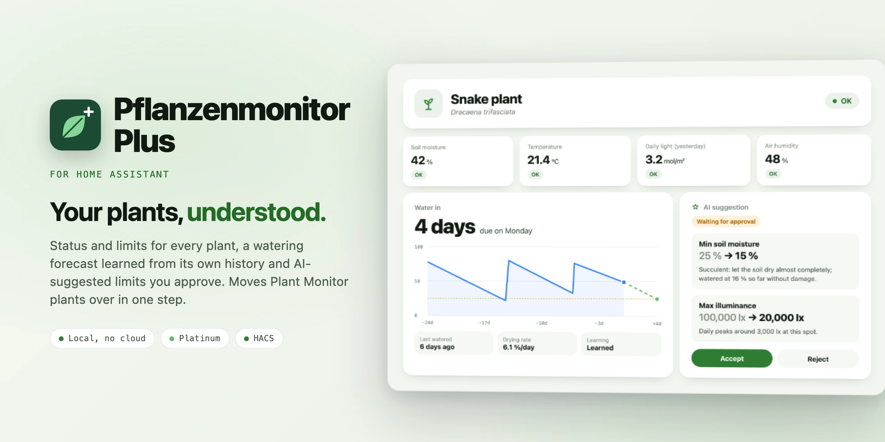

<div align="center">

<picture>
  <source media="(prefers-color-scheme: dark)" srcset="docs/images/readme-title-dark.webp" />
  
</picture>

<p>The plant integration for Home Assistant that learns: status and limits for every plant,<br/>
a watering forecast from each plant's own history, AI-suggested limits you approve.</p>

[](https://github.com/SH1FT-W/pflanzenmonitor-plus/releases/latest)
[](https://www.home-assistant.io)
[](https://hacs.xyz)
[](https://developers.home-assistant.io/docs/creating_integration_manifest/#iot-class)
[](custom_components/pflanzenmonitor_plus/quality_scale.yaml)
[](LICENSE)

<p><a href="https://sh1ft-w.github.io/pflanzenmonitor-plus"><b>Website</b></a> &nbsp;·&nbsp; <a href="#features">Features</a> &nbsp;·&nbsp; <a href="#installation">Install</a> &nbsp;·&nbsp; <a href="#moving-from-plant-monitor">Moving from Plant Monitor</a> &nbsp;·&nbsp; <a href="#entities">Entities</a> &nbsp;·&nbsp; <a href="#automations">Automations</a> &nbsp;·&nbsp; <a href="#troubleshooting">Troubleshooting</a> &nbsp;·&nbsp; <a href="CHANGELOG.md">Changelog</a> &nbsp;·&nbsp; <a href="README.de.md">Deutsch</a></p>

</div>

<br/>

Pflanzenmonitor Plus watches every plant against its limits, learns from the soil moisture history when it was watered
and when it needs water again, and optionally lets an AI suggest limits that fit the species. It does everything
[Plant Monitor](https://github.com/Olen/homeassistant-plant) does and can take over its plants in one step, keeping
entity IDs and history.

Everything runs locally from Home Assistant's own statistics. Only the optional AI suggestions go to the AI you set up
in Home Assistant. No extra packages.

> [!NOTE]
> Pflanzenmonitor Plus is an independent project. It is compatible with Plant Monitor (Olen/homeassistant-plant) but
> contains none of its code and is not affiliated with it.

<br/>

<a id="features"></a>
## Features

<!-- cards:features -->
<table>
<tr><td width="50%" valign="top"><picture><source media="(prefers-color-scheme: dark)" srcset="docs/images/icons/flower-outline-dark.svg"></picture> <b>Status like plant.*</b><br>OK or problem per plant, with problems, the status of every reading and the species, so cards and templates keep working.</td><td width="50%" valign="top"><picture><source media="(prefers-color-scheme: dark)" srcset="docs/images/icons/gauge-dark.svg"></picture> <b>Every reading on the plant</b><br>Soil moisture, temperature, soil temperature, humidity, illuminance or PPFD, conductivity and CO2, plus VPD, PPFD and daily light.</td></tr>
<tr><td width="50%" valign="top"><picture><source media="(prefers-color-scheme: dark)" srcset="docs/images/icons/tune-variant-dark.svg"></picture> <b>Limits you set</b><br>Min and max for every measurement, 5 % hysteresis, which readings count as a problem, a wait after watering.</td><td width="50%" valign="top"><picture><source media="(prefers-color-scheme: dark)" srcset="docs/images/icons/water-outline-dark.svg"></picture> <b>Water in X days</b><br>A forecast from the plant's own past cycles, scaled to how fast the soil dries today.</td></tr>
<tr><td width="50%" valign="top"><picture><source media="(prefers-color-scheme: dark)" srcset="docs/images/icons/watering-can-outline-dark.svg"></picture> <b>Last watered, detected</b><br>A jump in soil moisture is a watering. Nothing to press, nothing to enter.</td><td width="50%" valign="top"><picture><source media="(prefers-color-scheme: dark)" srcset="docs/images/icons/creation-outline-dark.svg"></picture> <b>AI suggestions you approve</b><br>Limits for the species with reasons, safety rules in code, undo any time.</td></tr>
<tr><td width="50%" valign="top"><picture><source media="(prefers-color-scheme: dark)" srcset="docs/images/icons/weather-snowy-rainy-dark.svg"></picture> <b>Rain and frost outdoors</b><br>Rain does not count as watering; frost risk from the hourly forecast.</td><td width="50%" valign="top"><picture><source media="(prefers-color-scheme: dark)" srcset="docs/images/icons/lightning-bolt-outline-dark.svg"></picture> <b>Automations</b><br>Problem detected, a reading became too low or too high, a sensor became stale: 43 triggers, 35 conditions.</td></tr>
</table>
<!-- /cards:features -->

- **Status like `plant.*`:** each plant gets one status entity (`ok` / `problem`) with the attributes Plant Monitor
  cards and templates read (`problems`, `moisture_status` and friends, `species`).
- **Readings and light:** the real sensors are mirrored on the plant's device; Plus adds VPD, PPFD, the total light
  integral and the daily light integral (today, yesterday, last 24 hours).
- **Limits:** min/max for every measurement and the lux-to-PPFD factor, as settings on the device page. Choose per
  measurement whether it counts as a problem; a wait after watering keeps "too wet" quiet.
- **Logbook:** start and end of every problem.
- **Water in X days:** a forecast from earlier watering cycles of the same plant, scaled to today's drying rate (in
  autumn soil dries more slowly than in summer).
- **Last watered** is detected as soon as the moisture jumps; there is nothing to press or enter.
- **Drying rate** in percentage points per day and a **learning status** ("Still learning" until two full watering
  cycles were seen, then "Learned").
- **AI suggestions for limits** (optional): once a plant is learned, an AI through Home Assistant's own AI task
  (`ai_task`, e.g. Claude) suggests limits for the species, with reasons. Nothing changes until you accept; every
  change can be undone.
- **Plants outdoors:** rain does not count as watering; "Rain expected" (≥ 1 mm in 12 h) and "Frost risk" (forecast
  for the next 48 h below the plant's minimum temperature).
- **Repairs:** moving plants over from Plant Monitor, new AI suggestions (accept or reject right in the dialog), and
  automations that still use old `plant.*` entities after the move.

## Requirements

- Home Assistant 2026.9 or newer with the recorder (default)
- A soil moisture sensor per plant for learning and the watering forecast (all other sensors are optional)
- Outdoors, optionally: a weather entity with an hourly forecast and a rain sensor
- For AI suggestions, optionally: an AI task entity (`ai_task`, e.g. from the Anthropic or OpenAI integration)

<a id="installation"></a>
## Installation

### HACS (custom repository)

1. In HACS, open the three dots menu, choose **Custom repositories** and add
   `https://github.com/SH1FT-W/pflanzenmonitor-plus` with the type **Integration**.
2. Search for **Pflanzenmonitor Plus**, download it and restart Home Assistant.

### Manual

1. Download the [latest release](https://github.com/SH1FT-W/pflanzenmonitor-plus/releases/latest).
2. Copy the folder `custom_components/pflanzenmonitor_plus` into `/config/custom_components/` and restart Home
   Assistant.

## Setup

*Settings → Devices & services → Add integration → Pflanzenmonitor Plus.* There is exactly one entry; the plants
are listed under it. All fields are optional and can be changed later under *Configure*.

| Field | Meaning |
|---|---|
| AI for limit suggestions | AI task entity. The first one is suggested. Empty = no AI suggestions (and no buttons). |
| Weather | Weather entity with an hourly forecast. The first one is suggested. Only for plants outdoors. |
| Rain sensor | Measured rain intensity in mm/h (device class precipitation intensity). Lets Plus tell rain from watering outdoors. Without it, or before it has history, rises outdoors count as unknown. Amount sensors ("rain today") do not work: they stay above 0 until midnight after a shower. |

### Add or edit a plant

*Pflanzenmonitor Plus → Add plant* asks in three steps; *⋮ → Reconfigure* on the plant changes the same things (the
room then lives on the device).

| Step | Fields |
|---|---|
| Plant | Name, species (e.g. "Dracaena trifasciata"; helps the AI and is shown as model on the device), room, picture (URL or `/local/…`) |
| Sensors | Soil moisture, air temperature, soil temperature, air humidity, illuminance (lx or PPFD), conductivity, CO2; "Outdoors" (preselected for rooms like terrace, balcony or garden) |
| Problems | Which readings count as a problem (default: all but VPD), wait after watering in minutes |

Plus only creates entities for sensors that are set. When you remove a sensor, its entities go away and its limits
stay stored. When you rename a sensor in Home Assistant, Plus follows.

<a id="moving-from-plant-monitor"></a>
## Moving from Plant Monitor

If Plant Monitor still has plants, *Settings → Repairs* shows "Move plants over from Plant Monitor". The dialog says
what happens and, once you confirm, moves all plants:

- taken over are the sensors, the limits **currently set** (from Plant Monitor's limit entities, not the start values
  in its entry; temperatures converted to °C), species, picture, which readings count as a problem, the wait after
  watering, "outdoors", the device's room and labels, and the entities' names, icons, labels, hidden/disabled flags,
  display and voice assistant settings, plus the live state (light sums, daily light today and yesterday, current
  problems)
- entity IDs stay the same and history continues; only `plant.<name>` becomes `sensor.<name>`
- what Plus has learned and the AI history stay
- afterwards the plants are **removed from Plant Monitor**; you can uninstall it in HACS

Plant Monitor has to be running for the move (only then are the current limits known). Automations and scripts that
still use `plant.<name>` or the old devices are listed under Repairs with the new IDs. Home Assistant cannot search
dashboards: replace the IDs there yourself.

<a id="entities"></a>
## Entities

All entities appear on the plant's device. Entity IDs depend on language and room (e.g.
`sensor.bedroom_snake_plant_water_in`); look them up on the device page for automations.

| Entity | Value | Attributes |
|---|---|---|
| *Plant name* (status) | OK · Problem · unknown (no reading) | Species, status of every measurement (too low / too high / OK), problems (measurement, status, value, limits) |
| Soil moisture, temperature, soil temperature, air humidity, illuminance, conductivity, CO2 | Value of the real sensor (its unit); after a restart the last value for up to 10 minutes until the sensor reports again | Source sensor |
| Vapour pressure deficit | kPa from temperature and humidity | – |
| Daily light (DLI) | mol/m² since midnight | Yesterday |
| PPFD, total light integral, light last 24 h (diagnostic, hidden) | mol/(s·m²) or mol/m² | – |
| Max/Min per measurement, lux-to-PPFD factor (configuration) | Limits; temperatures in your unit system | – |
| Watering due | Time (Home Assistant shows "in 5 days"); due = today 0:00 | – |
| Water in | Days until the lower limit, 0 = today (for automations) | Due on, lower limit, basis (past cycles or current rate) |
| Last watered | Time | outdoors: last rain, rain history (available / none yet) |
| Drying rate (diagnostic) | %/day over the last 72 h; unknown in the first 24 h after watering | – |
| Learning status (diagnostic) | No data · Still learning · Learned | Cycles seen, cycles needed, "usually watered at" |
| Rain expected, frost risk (outdoors, with weather) | on/off | Amount, until · lowest temperature, time, plant minimum |
| AI suggestion (with AI) | None yet · Waiting for approval · Limits fit · Accepted · Rejected · Undone | Summary, "old → new" and reason per limit, confidence, species, asked, next check, last accepted, last error |
| Buttons (with AI) | Accept suggestion · Reject suggestion (only while one is open) · Undo suggestion (right after accepting) · Ask AI now | – |

Moisture-based learning needs the soil moisture sensor; without it a plant has status, readings and limits only.

## Status and problems

Like Plant Monitor, so automations keep working after the move:

- Every measurement is "too low" (below min), "too high" (above max) or "OK". Once too low, it stays so until the value
  is 5 % above the limit (at most 5 % of the range), and the other way round – no flapping at the limit.
- A plant has a **problem** when a measurement that counts as a problem is too low or too high. Illuminance only counts
  when it is too bright (it is dark every night). Daily light is checked against yesterday; 0 (nothing measured) is
  OK. If the light sensor already measures PPFD, there is no lux check.
- **Wait after watering:** if soil moisture jumps by 10 points or more, "too wet" does not count as a problem for that
  long (the measurement's status still shows it).
- Temperatures are compared in °C, also when a sensor reports °F.
- A sensor that drops out neither starts nor ends a problem; the logbook reports the end only once it reports a value
  in range again.

<a id="automations"></a>
## Automations

Triggers (target: the status entity of one or more plants, also by area or label):

- Plant problem detected · plant problem cleared
- per measurement: became too low · became too high · became OK (soil moisture, conductivity, temperature, humidity,
  CO2, soil temperature, illuminance, daily light, VPD)
- per sensor: became stale (unavailable, or no report for a while, default 24 h; a report with the same value counts)
  · reports again

Conditions: plant has a problem · per measurement is too low / too high / OK · per sensor is stale.

Action `pflanzenmonitor_plus.replace_sensor`: `meter_entity` (a reading of the plant, e.g. its soil moisture),
`new_sensor` (the new real sensor; empty = remove). Plus reloads afterwards.

Example – a notification when a plant has needed attention for 30 minutes:

```yaml
triggers:
  - trigger: pflanzenmonitor_plus.problem_detected
    target:
      label_id: plants
    options:
      behavior: each
      for:
        minutes: 30
actions:
  - action: notify.mobile_app_phone
    data:
      message: "{{ trigger.to_state.name }} needs attention"
```

## How learning works

1. Plus reads the hourly long-term statistics of the plant's moisture sensor (up to 120 days, at most once an hour)
   and appends the current value. It also reads its own mirror of that sensor and takes the longer history (after the
   move, the mirror continues Plant Monitor's). The other sensors (temperature, humidity, light) are only needed for
   the AI summary; Plus reads 30 days of them.
2. **Detecting watering:** if the maximum of an hour is at least 10 percentage points above the minimum of the three
   hours before, that is a rise. Steps within 12 hours count as one event. After gaps in the history (sensor or Home
   Assistant off) nothing is compared, and a short dip (many sensors briefly report 0 after a restart) does not count.
   A single spike (one hour with a maximum of 100 at a normal mean) does not count either: a rise only counts once the
   hourly mean, or that of the next hour, is clearly above the starting value. If the moisture jumps like that in
   between, Plus recalculates right away; "Last watered" gets the start of the hour in which the watering was seen.
3. **Cycle** = from one watering to the next, at least 24 hours. A plant counts as learned after two cycles.
4. **Forecast:** for the last three cycles Plus measures how long the soil took from today's level to the lower limit
   (median), scaled by "rate then ÷ rate now" over the same 72 hours before that level (at most a factor of 3). Without
   a matching cycle: the current rate.
5. **Target** is the plant's lower soil moisture limit. The watering habit (median moisture before the last
   waterings) is shown for information only.

In a back test on real data (7 indoor plants, 120 days) the forecast was typically 1 to 3 days off.

**Limit: repotting, a new sensor, a new place.** Plus learns from all cycles of the last 120 days and cannot know that
the plant changed. After repotting (other substrate, bigger pot), a newly placed sensor or a move to the window the old
cycles do not fit for a while; the forecast adapts through the rate ratio but is only reliable again after two new
cycles. There is no "reset learning" per plant yet.

## AI suggestions

1. **When:** once a plant is "Learned", then automatically at most every 30 days (at most one plant per 10-minute
   run). "Ask AI now" asks right away. After an error, at the earliest after 6 hours. When you enter or change the
   species, Plus asks again on the next run.
2. **What the AI gets:** name, species (if set), room, indoors/outdoors, month, country, current limits, learned
   numbers (cycles, usually watered at, moisture after watering, days between waterings, rate) and min/mean/max of the
   last 30 days (soil moisture, air and soil temperature, humidity), plus for light the daily peaks and the daily light
   per day from the same illuminance sensor. No locations, no people.
3. **What it returns:** lower and upper limits for soil moisture, temperature, soil temperature, humidity,
   illuminance and daily light – only limits the plant has a sensor for (not CO2 and VPD) – one sentence of reasoning
   each and a confidence. Illuminance and daily light depend on where the sensor sits (often a room sensor, not at
   the plant), so the AI aligns them with the measured history. Plus builds the summary itself from the values after
   the safety rules. Tip: set the species – without it the AI guesses from the name and the confidence is at most
   "medium".
4. **Safety rules (in code, not in the prompt):** per suggestion at most ±15 points moisture/humidity, ±5 °C,
   ±2000 lx (min) or ±20000 lx (max) illuminance, ±5 or ±10 daily light; fixed ranges per value (e.g. moisture
   5–100 %, minimum temperature −15 to 25 °C); every lower limit with a gap below its upper limit (moisture/humidity 10,
   temperatures 5 °C, illuminance 2000 lx, daily light 2), otherwise both values of the pair stay. **First step free:**
   limits Plus never wrote (all but soil moisture and minimum temperature) are usually still start values – the AI may
   replace them in one step once (shown as "set for the first time"); after that the steps apply to them too. A value
   you changed by hand since the last request counts as set and is only adjusted step by step. Temperature limits are
   always in °C; if the light sensor already measures PPFD, there are no lux limits (daily light still). Larger changes
   go step by step: the suggestion names the AI's target ("target 65 %, step by step"), and after accepting a limited
   step Plus asks for the next one after 7 instead of 30 days. Outdoors (pots), the minimum temperature never goes
   below −5 °C (air) or 0 °C (soil), and outside the summer months max illuminance and max daily light are never
   lowered.
5. **Approval:** "Accept suggestion" checks the safety rules again against the values of now (if something was
   changed by hand in the meantime, nothing happens – ask again), writes the values to the plant's limits and keeps the
   old ones. "Undo suggestion" restores them as long as nobody changed the values since. Note: a higher minimum
   temperature can raise a problem and "Frost risk" right away.

Every new open suggestion fires the event `pflanzenmonitor_plus_suggestion` (`entity_id` of the plant's status
entity, `summary`, `changes`) – for example for a notification.

## Known limitations

- Small top-ups below 10 percentage points are not detected as watering.
- The forecast needs history: right after setup "Water in" usually only shows the current rate; in the first 24 hours
  after watering there is no rate (excess water drains).
- Outdoors without a rain sensor (or before its first data) rises stay "unknown"; "Last watered" stays empty there,
  the forecast still works.
- Soil moisture percentages of different sensors and substrates are not comparable; learning is per plant.
- AI suggestions cost a little at your AI provider per request (one request per plant and month). The AI can be
  wrong – hence the safety rules and the approval.
- OpenPlantbook is not supported (yet).

<a id="troubleshooting"></a>
## Troubleshooting

- **"No data":** the moisture sensor has no long-term statistics (yet). It needs `state_class: measurement`;
  statistics are created hourly.
- **"Water in" unknown:** no history yet, or the soil is not drying right now (first 24 hours after watering).
- **Status "unknown":** no sensor of the plant reports a value; check the reading entities and their "source sensor".
- **AI suggestion stays "None yet":** the plant is not learned yet, or the AI did not answer (attribute "last
  error"). "Ask AI now" shows the error directly.
- **Diagnostics:** *Pflanzenmonitor Plus → ⋮ → Download diagnostics* shows per plant all detected rises, the source of
  the history, the learned values, limits, live state and the last AI suggestion.

## Removal

*Settings → Devices & services → Pflanzenmonitor Plus → ⋮ → Delete.* Plants, devices, entities, repairs and stored
data (limits, live state, AI suggestions) are removed. To remove a single plant, use *⋮ → Delete* on its entry. Then
delete the folder `custom_components/pflanzenmonitor_plus` and restart Home Assistant.

## Development

```bash
python -m pytest tests -q -p no:logging --cov=custom_components.pflanzenmonitor_plus
uvx ruff check . && uvx ruff format --check .
uvx mypy@2.3.1 --python-executable <venv>/bin/python
python tools/pruefe-uebersetzungen.py    # strings.json against translations/*.json
```

Install the test requirements with `pip install -r requirements_test.txt`. The same checks run on GitHub Actions for
every push and pull request, plus HACS validation and hassfest. What the code relies on in Home Assistant is listed in
[`docs/ha-annahmen.md`](docs/ha-annahmen.md).

## License

[Apache License 2.0](LICENSE), Copyright 2026 SH1FT-W. See [`NOTICE`](NOTICE) about Plant Monitor.
