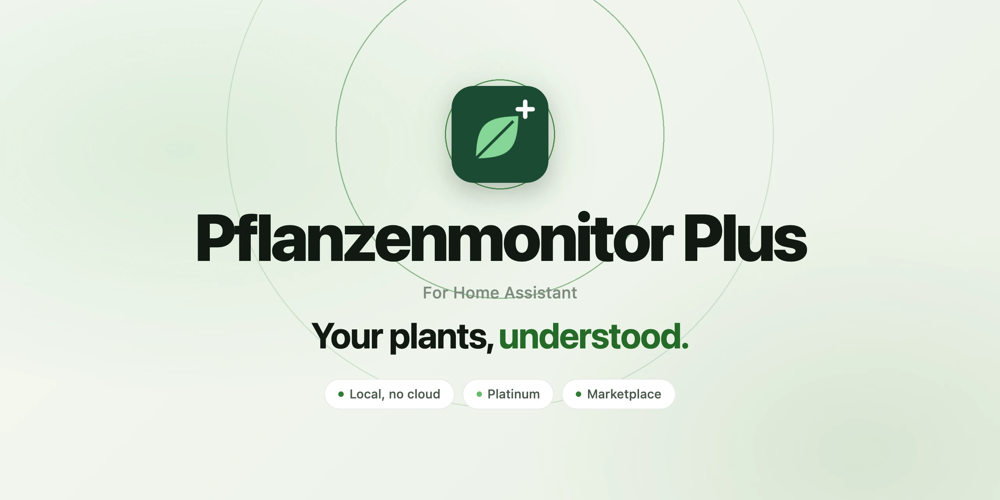

<div align="center">

<picture>
  <source media="(prefers-color-scheme: dark)" srcset="docs/images/readme-title-dark.webp" />
  
</picture>

[](https://github.com/SH1FT-W/pflanzenmonitor-plus/releases/latest)
[](https://www.home-assistant.io)
[](https://hacs.xyz)

<a href="https://sh1ft-w.github.io/pflanzenmonitor-plus"><b>Website</b></a>&emsp;<a href="#get-started">Get started</a>&emsp;<a href="#moving-from-plant-monitor">Moving from Plant Monitor</a>&emsp;<a href="#entities">Entities</a>&emsp;<a href="CHANGELOG.md">Changelog</a>&emsp;<a href="README.de.md">Deutsch</a>

</div>

<br/>

Pflanzenmonitor Plus watches every plant in Home Assistant against its limits, learns from the soil moisture history **when it was watered and when it needs water again**, and optionally lets an AI suggest limits that fit the species. Everything runs locally from Home Assistant's own statistics; only the optional AI requests go to the AI you set up.

It does what [Plant Monitor](https://github.com/Olen/homeassistant-plant) does, but it is a separate integration and takes nothing over from it: moving is [a few steps per plant](#moving-from-plant-monitor). The status entity is `sensor.<name>` instead of `plant.<name>`, and the Flower Card is not supported.

## What you get

| Feature | Needs |
|:--|:--|
| Status per plant (OK or problem), readings, limits, logbook, automations | Any sensors of the plant |
| VPD, PPFD and daily light | Temperature and humidity, or a light sensor |
| Water in X days, last watered (detected by itself), drying rate | A soil moisture sensor with long-term statistics (`state_class: measurement`) |
| Rain does not count as watering | Outdoors: a rain sensor in mm/h |
| Rain expected, frost risk | Outdoors: a weather entity with an hourly forecast |
| Limits suggested by an AI, you approve | An AI task entity (`ai_task`, for example from the Anthropic or OpenAI integration) |
| Watering tasks on a to-do list | A to-do list, chosen in the options |
| Care calendar for fertilizing and repotting | The option *Care calendar* (off by default); with AI, a care plan per season |

**New in 26.11:** watering tasks on a to-do list and an optional care calendar. Plus no longer moves plants from Plant Monitor by itself; there is a guide instead. Every change is in the [changelog](CHANGELOG.md).

<a id="get-started"></a><a id="installation"></a><a id="install"></a><a id="set-up"></a>
## Get started

[](https://my.home-assistant.io/redirect/hacs_repository/?owner=SH1FT-W&repository=pflanzenmonitor-plus&category=integration)

You need Home Assistant 2026.9 or newer with the recorder (the default).

1. **Install it.** Search for **Pflanzenmonitor Plus** under **Settings > Marketplace** (called HACS before Home Assistant 2026.11), download it and restart Home Assistant.
2. **Add the integration.** **Settings > Devices & services > Add integration > Pflanzenmonitor Plus**. There is exactly one entry; the plants are listed under it.
3. **Choose the options** (all optional, later under **Configure**): the AI for limit suggestions, a weather entity, a to-do list for watering, the care calendar, a rain sensor. Use a rain sensor that measures intensity in mm/h; amount sensors ("rain today") stay above 0 until midnight.
4. **Add a plant.** **Pflanzenmonitor Plus > Add plant** asks in four steps: name, species (helps the AI), room and picture; the sensors and whether it is outdoors; which readings count as a problem and the wait after watering; with the care calendar on, the care plan. **Three dots > Reconfigure** changes the same later.

Plus only creates entities for sensors that are set. A removed sensor takes its entities along, its limits stay stored. When you rename a sensor, Plus follows.

<details>
<summary>Install by hand</summary>

1. Download the [latest release](https://github.com/SH1FT-W/pflanzenmonitor-plus/releases/latest).
2. Copy `custom_components/pflanzenmonitor_plus` into `/config/custom_components/` and restart Home Assistant.

</details>

<a id="moving-from-plant-monitor"></a>
## Moving from Plant Monitor

Plus does not read, change or remove anything of Plant Monitor. While Plant Monitor is set up, **Settings > Repairs** shows a notice with a link here. Move each plant by hand:

1. **Note the plant's settings** in Plant Monitor: sensors, limits (its min and max entities), species, picture, which readings count as a problem, the wait after watering and the room.
2. **Delete the plant in Plant Monitor first.** This frees its entity IDs; otherwise Plus gets IDs ending in `_2` that stay. The old history stays under the old IDs.
3. **Add it in Plus** with the same name and the real sensors Plant Monitor used, and **leave Room empty**: with a room, Home Assistant puts it in front of every new entity ID. Set the room on the device afterwards, then the limits.
4. **Replace `plant.<name>`** with `sensor.<name>` in automations, scripts and dashboards (same states and attributes). Readings and limits keep their IDs where the names match. Older plants in a Home Assistant not set to English had English IDs (`sensor.<plant>_soil_moisture`); Plus names them in your language, so replace those too.
5. **Remove Plant Monitor** in the Marketplace once all plants are moved, and restart. The notice disappears.

Nothing is carried over: entity names, icons, labels, hidden or disabled entities and Plant Monitor's light sums start fresh. The watering forecast learns from the real moisture sensor's statistics, which stay. Moved with Plus up to 26.11.2, which moved plants itself? Nothing changes; automations that still use `plant.<name>` stay listed under Repairs.

<a id="entities"></a>
## Entities

All on the plant's device. IDs depend on language and room (for example `sensor.bedroom_snake_plant_water_in`); look them up on the device page.

| Entity | Shows |
|:--|:--|
| *Plant name* (status) | OK, problem, or unknown without a reading. Attributes like Plant Monitor's `plant.*`: species, status per measurement, problems |
| Soil moisture, temperature, soil temperature, humidity, illuminance, conductivity, CO2 | The real sensor's value. Attribute: source sensor |
| Vapour pressure deficit, daily light (DLI) | kPa from temperature and humidity; mol/m² since midnight, yesterday as attribute |
| Max and min per measurement, lux-to-PPFD factor | The limits, as settings on the device page |
| Water in, watering due | Days until the lower limit (0 = today), and the date |
| Last watered | Detected from a jump in soil moisture. Outdoors also the last rain |
| Rain expected, frost risk | Outdoors with weather: at least 1 mm in 12 hours; the forecast for 48 hours below the plant's minimum temperature |
| AI suggestion, with buttons | The open suggestion with "old to new" and a reason per limit. Buttons: Accept, Reject, Undo, Ask AI now |

<details>
<summary>Diagnostic entities, care calendar, actions and events</summary>

- **Diagnostic:** drying rate (%/day over 72 hours), learning status (no data, still learning, learned after two watering cycles), PPFD, total light integral, light in the last 24 hours.
- **Care calendar** (option): calendar **Plant care** (`calendar.plant_care`, German `calendar.pflanzenpflege`) with fertilizing and repotting dates as all-day events, and per plant the buttons **Fertilized** and **Repotted**.
- **Actions:** `pflanzenmonitor_plus.replace_sensor` (`meter_entity`, `new_sensor`; empty removes it) and `pflanzenmonitor_plus.care_done` (`plant_entity`, `care`: `fertilized` or `repotted`, optional `date`).
- **Event:** `pflanzenmonitor_plus_suggestion` for every new open AI suggestion (`entity_id`, `summary`, `changes`).
- **Triggers and conditions** for the plant's status entity, also by area or label: problem detected or cleared; per measurement too low, too high or OK; per sensor stale (unavailable or no report for 24 hours by default) or reporting again.

</details>

<a id="examples"></a>
## Examples

A notification when a plant has needed attention for 30 minutes:

```yaml
triggers:
  - trigger: pflanzenmonitor_plus.problem_detected
    target:
      label_id: plants
    options:
      behavior: each
      for:
        minutes: 30
actions:
  - action: notify.mobile_app_phone
    data:
      message: "{{ trigger.to_state.name }} needs attention"
```

<details>
<summary>Reminder in the morning when something is due in the care calendar</summary>

```yaml
triggers:
  - trigger: calendar
    event: start
    entity_id: calendar.plant_care
actions:
  - action: notify.mobile_app_phone
    data:
      message: "{{ trigger.calendar_event.summary }}"
```

</details>

## Your data

- **Local.** Learning and the forecast use Home Assistant's own statistics. No extra packages.
- **The AI gets** name, species, room, indoors or outdoors, month, country, limits, learned numbers and 30 days of readings. No locations, no people.
- **Diagnostics** show per plant the detected waterings, learned values, limits and the last AI suggestion.

## Good to know

- Small top-ups below 10 percentage points are not detected as watering. Right after setup "Water in" only uses the current drying rate; in a back test on 7 indoor plants over 120 days the learned forecast was typically 1 to 3 days off.
- After repotting, a new sensor or a new place, the old cycles do not fit for a while. The forecast is reliable again after two new cycles; there is no "reset learning" yet.
- The AI can be wrong. Safety rules in code limit every step, nothing changes until you accept, and every change can be undone. Each request costs a little at your AI provider (about one per plant and month).
- Outdoors without a rain sensor, rises stay unknown and "Last watered" stays empty; the forecast still works.
- OpenPlantbook is not supported (yet).

<details>
<summary>Status and problems</summary>

Like Plant Monitor, so automations only need the new entity ID:

- Every measurement is too low, too high or OK. It switches back only 5 % past the limit (at most 5 % of the range), so it does not flap.
- A plant has a problem when a measurement that counts is out of range. Illuminance only counts when too bright (it is dark every night). Daily light is checked against yesterday. With a PPFD light sensor there is no lux check.
- If soil moisture jumps by 10 points or more, "too wet" does not count for the wait after watering.
- Temperatures are compared in °C, also from °F sensors. A sensor that drops out neither starts nor ends a problem.

</details>

<details>
<summary>How learning works</summary>

1. Plus reads up to 120 days of the moisture sensor's hourly statistics, at most once an hour.
2. **Watering** is a rise of at least 10 points from the minimum of the three hours before. Steps within 12 hours count as one; gaps, short dips to 0 and single spikes do not count.
3. A **cycle** runs from one watering to the next, at least 24 hours. Two cycles make a plant learned.
4. **Forecast:** for the last three cycles, how long the soil took from today's level to the lower limit (median), scaled by the drying rate then and now (at most a factor of 3). Without a matching cycle, the current rate.
5. The **target** is the lower soil moisture limit. The watering habit is shown for information only.

</details>

<details>
<summary>AI suggestions</summary>

1. **When:** once a plant is learned, then at most every 30 days, one plant per 10-minute run. "Ask AI now" asks right away. An open suggestion waits 30 days for you, then it is replaced.
2. **What it returns:** limits for soil moisture, temperature, soil temperature, humidity, illuminance and daily light (only those with a sensor), a reason each and a confidence. Without a species the confidence is at most "medium".
3. **Safety rules in code:** per suggestion at most ±15 points moisture or humidity, ±5 °C, ±2000 lx (min) or ±20000 lx (max), ±5 or ±10 daily light; fixed ranges per value and a gap between every lower and upper limit. Limits Plus never wrote may be replaced in one step once. Larger changes go step by step, the next one after 7 instead of 30 days. Outdoors the minimum temperature never goes below −5 °C (air) or 0 °C (soil).
4. **Approval:** accepting checks the rules again against the values of now and keeps the old ones for undo. A higher minimum temperature can raise a problem and "Frost risk" right away.

New suggestions also show under **Settings > Repairs**, with Accept and Reject in the dialog.

</details>

<details>
<summary>Watering tasks and care calendar</summary>

**Watering tasks:** when "Water in" reaches today, Plus adds a task like "Water Yucca" to the chosen list, with a due date if the list supports it. At most one open task per plant, also across restarts. Plus completes it once the hourly statistics confirm the rise (one to two hours later). If you check it off or delete it yourself, the next task comes only after the plant was watered and is due again. Plants without a soil moisture sensor get no tasks.

**Care calendar:** fertilizing every N days within the season (winter pause), repotting every N years in the first month of the season. Default March to September every 21 days, repotting every 2 years; southern hemisphere September to March. Overdue dates stay on today. With AI, Plus asks once per season for a care plan per plant and shows a differing one under Repairs (interval 7 to 90 days, repotting every 1 to 10 years). Turning the option off removes calendar and buttons; the stored dates stay.

</details>

<details>
<summary>Troubleshooting</summary>

- **"No data":** the moisture sensor has no long-term statistics yet. It needs `state_class: measurement`.
- **"Water in" unknown:** no history yet, or the soil is not drying (first 24 hours after watering).
- **Status unknown:** no sensor of the plant reports a value. Check the reading entities and their source sensor.
- **AI suggestion stays "None yet":** the plant is not learned yet, or the AI did not answer (attribute "last error"). "Ask AI now" shows the error directly.

When you open an [issue](https://github.com/SH1FT-W/pflanzenmonitor-plus/issues), attach the diagnostics (**Pflanzenmonitor Plus > three dots > Download diagnostics**).

</details>

<details>
<summary>Remove</summary>

1. **Settings > Devices & services > Pflanzenmonitor Plus > three dots > Delete**. Plants, devices, entities, repairs and stored data go; tasks already on a to-do list stay. A single plant goes with **three dots > Delete** on its entry.
2. Remove it in the Marketplace (or delete `/config/custom_components/pflanzenmonitor_plus`) and restart Home Assistant.

</details>

<details>
<summary>Development</summary>

```bash
python -m pytest tests -q -p no:logging --cov=custom_components.pflanzenmonitor_plus
uvx ruff check . && uvx ruff format --check .
uvx mypy@2.3.1 --python-executable <venv>/bin/python
python tools/pruefe-uebersetzungen.py    # strings.json against translations/*.json
```

Test requirements: `pip install -r requirements_test.txt`. GitHub Actions runs the same checks plus HACS validation and hassfest. What the code relies on in Home Assistant is listed in [`docs/ha-annahmen.md`](docs/ha-annahmen.md). Quality scale: [self-assessed](custom_components/pflanzenmonitor_plus/quality_scale.yaml).

</details>

## License

[Apache License 2.0](LICENSE), Copyright 2026 SH1FT-W. See [`NOTICE`](NOTICE) about Plant Monitor.

<sub>Pflanzenmonitor Plus is an independent project. It is compatible with Plant Monitor (Olen/homeassistant-plant) but contains none of its code and is not affiliated with it.</sub>

<br/>

<div align="center">
<a href="https://sh1ft-w.github.io"></a>
<br/>
<sub>More open source for Home Assistant and the Mac at <a href="https://sh1ft-w.github.io">sh1ft-w.github.io</a></sub>
</div>
